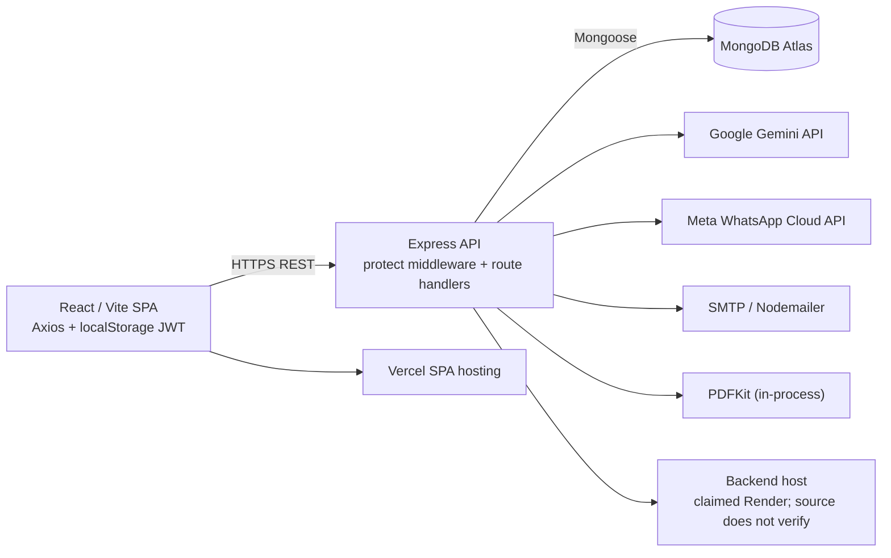

# Bizzrow Production Readiness Audit

**Audit date:** 2026-11-07
**Mode:** Read-only source audit. After the report was prepared, the user explicitly authorized fixes for the three reported authentication findings. Those narrow changes are recorded below; no production data, deployment, dependency, or index was changed.
**Overall assessment:** **Not ready to be the sole system of record for live inventory and financial operations until transaction support and financial integration behavior are verified on an isolated staging deployment.**

## 1. Executive summary

Bizzrow is a React 18/Vite single-page application backed by an Express 4/Mongoose API and MongoDB. Its current data model is effectively **one shop per user**: business profile and preferences are embedded on `User`, while each operational record is scoped by `owner: req.user._id`. The source has useful foundations—authenticated routes, owner filters on the main list/detail queries, pagination for products/sales/customers, a per-owner/year atomic invoice counter, and pure unit tests for sale math, returns, and query builders.

The most important launch blockers are operational correctness issues, not evidence that MongoDB alone is slow:

1. A full return after a bill-level discount can refund more than the recorded sale total. A source-level reproduction produced an INR 90 sale, INR 100 return, and a negative net sale balance.
2. Sales, returns, replacements, and ledger payments update multiple documents without a MongoDB transaction. Partial failures and concurrent requests can leave stock, sale, customer balance, ledger, and return records inconsistent.
3. Inventory availability is checked before an unconditional `$inc`; duplicate line items or concurrent sales can overdraw stock.
4. Payment input is not reconciled to the sale total or outstanding balance. In sales, `amountPaid` is capped but the original split-payment array is retained, and dashboard collections sum that array. Ledger payments can also exceed outstanding while the ledger records the full amount.
5. A sale request waits for the WhatsApp provider call after committing the sale. That adds external network latency to checkout and leaves a duplicate-sale risk if clients retry a slow/uncertain request.
6. Ledger history and statements read all entries for a customer, then filter in application memory. Dashboard, analytics, AI and health endpoints also load unbounded product/customer sets or month/range sale documents.
7. There is no service worker or web app manifest in this repository. The responsive site exists, but an offline-capable/installable PWA and its cache behavior are not implemented here.

**Latency cannot be assigned conclusively to the database, Render, network, or browser from source alone.** There is no request tracing, APM, database profiler output, production query plan, or representative dataset in this workspace. The query and request patterns below identify high-confidence sources of avoidable work and hypotheses to measure; no response-time figures are invented.

The delegated security review found three password-reset/session findings (one conditional on production environment configuration). It found no confirmed cross-tenant access defect in the reviewed route set; this is not a substitute for tenant-isolation integration tests or production verification.

After the audit, the user selected all three authentication findings for remediation. Reset-link logging was removed, API link disclosure now requires an explicit development-only opt-in, and password reset now increments a JWT token version so previously issued tokens are rejected.

The user subsequently authorized a financial-integrity sprint. The workspace now includes discounted return allocation, strict tender validation, oldest-due ledger payment allocation, transactional/idempotent sale/return/replacement/payment writes, conditional stock changes, and collection reporting for actual tender/refunds. These changes have not been deployed. The workspace has no configured Mongo URI, so production topology support is unverified and the opt-in replica-set integration test was skipped; the unchanged frontend also does not yet send the required idempotency header.

## Financial-integrity sprint status

- Business policy selected by the user: reject overpayments; do not retain customer-credit balances; record replacement carry-forward separately from tender; require idempotency keys; refund returns of credit-funded replacements in cash.
- Validation from the current workspace: **65 backend tests passed, 0 failed; 1 Mongo transaction integration test skipped** because `FINANCIAL_TEST_MONGO_URI` is not configured. Modified JavaScript files passed `node --check`; `npm run build` passed.
- No production data, deployment configuration, or database indexes were modified. An isolated replica-set test run and frontend idempotency-header follow-up are required before rollout.

## 2. Scope, method, and limits

Reviewed the frontend entry/routing, API client and principal pages; Express setup and middleware; route handlers; Mongoose models/index declarations; business logic/services; deployment-related files present in the workspace; and all existing backend tests.

**Safe validation performed**

- `node --test` from `server` before the security follow-up: **38 passed, 0 failed**; after the follow-up: **45 passed, 0 failed**.
- `npm run build` from `server` (script is `node --check server.js`): passed.
- `node --check` passed for the changed auth route, auth middleware, User model and new auth utilities.
- A non-persistent calculation using the existing sale math functions reproduced the bill-discount return mismatch described above.

**Not performed:** live requests, Atlas `explain()`/profiler checks, production configuration inspection, dependency advisory scan, frontend production build (would create build output), load test, browser/mobile profiling, or any database operation. The environment values and deployed Render/Vercel settings were not available. Declared indexes in source are not proof that those indexes exist in Atlas.

## 3. Architecture map

### Actual repository architecture

- **Frontend:** `client/src/main.jsx` mounts React Strict Mode, BrowserRouter, theme/auth contexts and the app. `client/src/App.jsx` eagerly imports the pages and defines public and protected routes. The authenticated application is rendered through `AppShell`/`Outlet`; pages call a shared Axios client. There is no React Query/TanStack Query/SWR cache.
- **Backend:** `server/server.js` builds an Express app, configures CORS, an 8 MB JSON parser and Morgan, mounts route files, then connects to Mongo before opening the HTTP listener. Route handlers contain most controller/business logic; there is no separate controller directory.
- **Persistence:** Mongoose models are `User`, `Product`, `Customer`, `Sale`, `LedgerEntry`, `ReturnRecord`, `AIInsight`, `WhatsAppLog`, and `Counter`. Operational ownership is represented by a `User` ObjectId, not a separate `Business`/membership model.
- **Integrations:** Google Gemini (`aiService`), Meta WhatsApp Cloud API (`whatsappService`), SMTP via Nodemailer (`mailer`), and PDFKit (`pdfService`).
- **Deployment evidence in repository:** Vercel SPA rewrite configuration exists in `client/vercel.json`. No Render deployment manifest/Procfile/container definition was found. README hosting labels say Vercel + Railway, so they do not confirm the stated Render Starter deployment.
- **Mobile/PWA:** responsive UI and mobile navigation exist. No manifest/service-worker registration or service-worker implementation was found.

### Major module and route inventory

| Area | Frontend | Backend route/model/service |
|---|---|---|
| Auth/settings | `Login`, `Register`, `ForgotPassword`, `ResetPassword`, `Settings`, `AuthContext` | `auth.js`, `settings.js`, `User`, `auth` middleware, `mailer` |
| Inventory/OCR | `Products` | `products.js`, `Product`, `aiService`, `ocrNormalize` |
| Sales/invoices | `Sales` | `sales.js`, `Sale`, `Counter`, `invoiceService`, `saleMath`, `pdfService`, `whatsappService` |
| Customers/ledger | `Ledger` | `customers.js`, `ledger.js`, `Customer`, `LedgerEntry`, `pdfService`, `whatsappService` |
| Dashboard/analytics | `Dashboard` | `dashboard.js`, `health.js`, `Sale`, `Product`, `Customer`, `AIInsight`, `healthService`, `profit` |
| AI insights | `AIInsights` | `ai.js`, `AIInsight`, `aiService` |
| WhatsApp | `WhatsApp` | `whatsapp.js`, `WhatsAppLog`, `whatsappService` |

There is **no Supplier model/route, purchase-entry workflow, inventory-movement model, or expense model** in the inspected source. Stock is a mutable product field rather than a reconciled movement ledger. Sales expose create/list/detail/return/replacement/invoice operations, but no sale edit/cancel route was found.

## 4. Performance and latency audit

Severity below describes source-level risk, not measured production impact.

### PERF-01 — Sale POST waits on WhatsApp delivery

- **Severity:** P1 latency/reliability risk; confirmed execution path, production impact unmeasured.
- **Affected feature:** New sale checkout.
- **Frontend:** [Sales.jsx](./client/src/pages/Sales.jsx#L487) awaits `POST /sales`.
- **Backend:** [sales.js](./server/routes/sales.js#L366) awaits `whatsapp.sendInvoice()` before responding. The WhatsApp service calls `fetch()` without a timeout ([whatsappService.js](./server/services/whatsappService.js#L65), [whatsappService.js](./server/services/whatsappService.js#L188)).
- **Root cause:** For a customer sale with auto-invoice enabled (the user preference defaults to true), the external provider call is on the synchronous checkout response path. Provider slowness or an unresolved network request extends the apparent time to record a sale. The sale and stock changes have already been written, so a client timeout/retry can create another sale.
- **Validate:** Capture browser timing for `POST /sales`; add server spans around each DB operation and WhatsApp call; compare p50/p95 with auto-invoice on/off in staging. Do not infer this latency from Render or Atlas alone.
- **Recommendation/benefit:** Commit the business transaction first, return promptly, and send WhatsApp asynchronously through a durable outbox/queue with delivery status and idempotent retries. Add a bounded provider timeout. This removes provider round-trip time from checkout while preserving delivery tracking.
- **Regression risk:** Queue/outbox delivery must not report a message as sent before provider confirmation; preserve current invoice content and retry semantics.

### PERF-02 — Checkout performs sequential product lookups and writes

- **Severity:** P2; confirmed N-per-item round trips.
- **Affected feature:** Sales with multiple distinct products; replacements follow a similar path.
- **Evidence:** [sales.js](./server/routes/sales.js#L257) looks up each product in a serial loop; after creating the sale, [sales.js](./server/routes/sales.js#L327) updates each product serially. The replacement helper has corresponding loops at [sales.js](./server/routes/sales.js#L92) and [sales.js](./server/routes/sales.js#L141).
- **Root cause:** Request time grows with number of line items and database round trips. These operations are not safely parallelizable as-is because stock validation and multi-document consistency depend on the result.
- **Recommendation/benefit:** After transaction/idempotency and stock-guard design, fetch products in one owner-scoped query and use conditional atomic stock updates in a transaction. Measure first; do not parallelize writes without preserving all-or-nothing behavior.
- **Regression risk:** Duplicate product IDs in one sale and concurrent checkout must be handled correctly; tests must assert exact stock and rollback behavior.

### PERF-03 — Product/customer searches use substring regex and duplicate counts

- **Severity:** P2; query-plan impact is a hypothesis pending Atlas `explain()`.
- **Affected feature:** Product search, customer search, and sales-name search.
- **Evidence:** Product listing runs `find + countDocuments` ([products.js](./server/routes/products.js#L26), [products.js](./server/routes/products.js#L43)); customer listing runs list, count and a portfolio aggregate ([customers.js](./server/routes/customers.js#L18), [customers.js](./server/routes/customers.js#L21)); `buildTextFilter` creates case-insensitive regular expressions across multiple fields ([search.js](./server/utils/search.js#L18)). Sales search uses a case-insensitive customer-name regex ([salesQuery.js](./server/utils/salesQuery.js#L16)).
- **Index coverage:** Owner/recent-list indexes exist, but unanchored case-insensitive substring regex across `$or` fields is not generally served efficiently by ordinary B-tree indexes. Search input is escaped, which is good; this finding is about query work, not regex injection.
- **Recommendation/benefit:** Capture query plans and examined/returned counts by query shape. If substring search is required at scale, evaluate Atlas Search or normalized/searchable fields; if prefix search is acceptable, define a normalized prefix strategy. Consider whether exact total counts are needed on every keystroke.
- **Index candidate:** No blind index addition. Test real data with `explain("executionStats")` first; any new compound index costs storage and slows writes.
- **Regression risk:** Search semantics, case behavior and pagination totals must remain compatible.

### PERF-04 — Ledger history and statements are unbounded

- **Severity:** P2; confirmed.
- **Affected feature:** Customer transaction history, statements and PDFs.
- **Evidence:** [ledger.js](./server/routes/ledger.js#L57) returns all entries for a customer. `computeStatement` reads the entire history and filters it in JavaScript ([ledger.js](./server/routes/ledger.js#L18)); both JSON and PDF statements use that helper.
- **Root cause:** Response size, DB transfer, JS iteration and PDF work grow with account age even when the requested date range is narrow.
- **Recommendation/benefit:** Push date bounds to Mongo, calculate opening balances using bounded aggregation or stored/verified checkpoints, and paginate long transaction histories. Preserve exact opening/running/closing balance semantics.
- **Regression risk:** Ordering and opening balance must remain stable around date boundaries and same-timestamp entries; PDF must represent exactly the same range as JSON.

### PERF-05 — Dashboard, AI, health and analytics scan broad tenant datasets

- **Severity:** P2; source work is confirmed, actual duration is unmeasured.
- **Evidence:** Dashboard summary launches many overlapping operations in `Promise.all`, including five sales aggregations, an all-product query selecting `image`, and all current-month sale items ([dashboard.js](./server/routes/dashboard.js#L66), [dashboard.js](./server/routes/dashboard.js#L100), [dashboard.js](./server/routes/dashboard.js#L118)). Revenue analytics loads all sales in the requested date range and all product costs ([dashboard.js](./server/routes/dashboard.js#L209)). Inventory/outstanding analytics load all products or customers ([dashboard.js](./server/routes/dashboard.js#L280), [dashboard.js](./server/routes/dashboard.js#L310)). AI refresh fetches all tenant products ([ai.js](./server/routes/ai.js#L31)); health endpoints fetch all products/customers and up to 90 days of sales ([health.js](./server/routes/health.js#L19)).
- **Recommendation/benefit:** Measure query plans, document counts and serialized response bytes. Consolidate overlapping aggregates, project only required fields, cap or summarize AI context, and move costly aggregates into incremental/appropriately cached summaries only if freshness requirements permit.
- **Regression risk:** Dashboard totals and AI context must remain tenant-scoped and financially consistent; stale caching is not acceptable for inventory/dues without explicit freshness UI.

### PERF-06 — Product payloads include embedded base64 images

- **Severity:** P2; confirmed payload amplification risk.
- **Evidence:** `Product.image` is stored as a base64 data URL ([Product.js](./server/models/Product.js#L20)). The product list returns full documents rather than a projection ([products.js](./server/routes/products.js#L44)); the dashboard also selects `image` for all products ([dashboard.js](./server/routes/dashboard.js#L100)). Sales product search requests up to 50 records ([Sales.jsx](./client/src/pages/Sales.jsx#L383)).
- **Recommendation/benefit:** Store image objects externally and return thumbnails/URLs or exclude image fields from endpoints that do not render them; use explicit response DTOs and measure transfer size.
- **Regression risk:** Existing product images and invoice/marketing views must continue rendering during any migration.

### PERF-07 — Pages refetch on navigation; no shared cache or request cancellation

- **Severity:** P2; source behavior confirmed, user-perceived impact not measured.
- **Evidence:** Pages are eagerly imported in [App.jsx](./client/src/App.jsx#L13) rather than route-lazy-loaded. Products and sales fetch on mount ([Products.jsx](./client/src/pages/Products.jsx#L73), [Sales.jsx](./client/src/pages/Sales.jsx#L158)); `AppShell` renders a route `Outlet` ([AppShell.jsx](./client/src/components/AppShell.jsx#L77)). Search is debounced, but requests have no cancellation or stale-response guard (product search at [Sales.jsx](./client/src/pages/Sales.jsx#L383)).
- **Root cause:** Navigating away and back remounts pages and reloads their data; slow overlapping searches may let an older response replace a newer result. The authenticated API client uses Axios, but no data-query cache is configured.
- **Recommendation/benefit:** First add request timing and verify the repeat-request rate. Then use route-level code splitting and a small shared cache with explicit invalidation for sales/stock/ledger mutations; add cancellation or request sequencing for search. Do not cache financially sensitive or fast-changing data without a freshness policy.
- **Regression risk:** Stale inventory/dues after writes, auth changes and logout must never be shown as current.

### PERF-08 — PWA behavior is not present in the source snapshot

- **Severity:** P2 product/readiness gap if installed-PWA/offline behavior is a launch requirement.
- **Evidence:** Search found no service-worker registration, service-worker file, `manifest.json`, Workbox, or PWA plugin. `index.html` links icons but has no manifest link; Vite config only installs React. No authenticated API cache strategy can therefore be verified here.
- **Recommendation/benefit:** Confirm what is deployed and whether it is only browser “Add to Home Screen.” If true PWA behavior is required, define installability, cache invalidation, logout/tenant isolation and offline-write rules before adding a service worker. Never cache authenticated business data by default.
- **Regression risk:** A stale-cache strategy can expose previous-session data or make stock/ledger writes appear successful offline.

### Performance investigation still required

Instrument one representative flow each for product list/search, sale creation, sales history, ledger history and dashboard. Capture browser network timing/bytes, server middleware/controller spans, Mongo query duration and `executionStats`, Render CPU/memory/restarts, and mobile throttled-network traces. Test typical and upper-bound tenant sizes. Atlas tier suitability cannot be assessed without those measurements and the deployed cluster tier.

## 5. Database and data-integrity audit

### Model and declared-index inventory

| Model | Important fields / query patterns | Declared indexes in source | Notes |
|---|---|---|---|
| `Product` | owner, name, category, sku, stock, soldCount, base64 image | owner; `{owner, createdAt}`; `{owner, name}` | List/recent query covered. Search regex and stock/soldCount sorts need plan review. SKU is not unique. |
| `Sale` | owner, customer, createdAt, paymentStatus, payments, items | owner; invoiceNumber; customer; `{owner, createdAt}`; `{owner, customer, createdAt}`; `{owner, paymentStatus, createdAt}` | Recent/date/status/customer cases have useful coverage. Highest/lowest total sort and customer-name regex need measurement. |
| `Customer` | owner, phone, updatedAt, pendingBalance | owner; unique `{owner, phone}`; `{owner, updatedAt}` | Recent listing covered; text search and all-customer summaries are broad. |
| `LedgerEntry` | owner, customer, createdAt, amount | owner; customer; `{owner, customer, createdAt}` | Composite history query has coverage, but it is unbounded in application behavior. |
| `ReturnRecord` | owner, sale, createdAt | owner; sale; `{owner, createdAt}`; `{owner, sale, createdAt}` | Sale-specific history has a matching composite index. |
| `AIInsight` | owner, kind, createdAt | owner; `{owner, kind, createdAt}` | Generic owner/recent and kind-specific paths. |
| `WhatsAppLog` | owner, createdAt | owner; `{owner, createdAt}` | Recent-log query has coverage. |
| `User` | email | unique email | Password is excluded in common protected reads. |
| `Counter` | string `_id`, seq | `_id` primary key | Atomic per-owner/year counter update supports concurrency-safe number allocation. |

Index declarations are in [Product.js](./server/models/Product.js#L40), [Sale.js](./server/models/Sale.js#L80), [Customer.js](./server/models/Customer.js#L19), [LedgerEntry.js](./server/models/LedgerEntry.js#L24), [ReturnRecord.js](./server/models/ReturnRecord.js#L35), [AIInsight.js](./server/models/AIInsight.js#L34), and [WhatsAppLog.js](./server/models/WhatsAppLog.js#L27). There is no evidence here of actual Atlas index state or index build/migration history.

### Confirmed integrity findings

#### DATA-01 — Bill-level discount is omitted from return allocation

Sale math applies bill discount after line subtotals ([saleMath.js](./server/utils/saleMath.js#L52), [saleMath.js](./server/utils/saleMath.js#L55)). Return processing refunds each returned quantity from the item's subtotal ([sales.js](./server/routes/sales.js#L33)) and passes that amount to settlement. For a one-item INR 100 sale with INR 10 bill discount, the sale total is INR 90 but a full return is valued at INR 100. The settlement then caps paid at zero without capping the return; `total - returnedAmount` becomes -10 while `amountPaid + dueAmount` is 0. This violates the invariant documented in [saleMath.js](./server/utils/saleMath.js#L76).

The existing return tests use undiscounted sales ([returns.test.js](./server/tests/returns.test.js#L1)); they do not cover bill discounts or discounted partial returns. **P1.** Define a deterministic allocation of bill discounts to line/quantity refunds, then test full/partial return, mixed payments, replacement and profit/collection totals.

#### DATA-02 — Sale and inventory writes are not atomic; stock check is race-prone

`POST /sales` reads product stock and checks availability before writing ([sales.js](./server/routes/sales.js#L257)); it then creates the sale ([sales.js](./server/routes/sales.js#L303)) and decrements stock via unconditional `$inc` ([sales.js](./server/routes/sales.js#L327)). Writes to stock, customer, and ledger are separate operations and there is no transaction. `createSaleFromItems` uses the same pattern. A database error after any write can leave partial state. Two requests can both pass the same stock check; duplicate product lines in a single request can independently pass against the same starting stock. The Product schema `min: 0` is not a substitute for a conditional update/transaction.

**P1.** Use a transaction where the deployed Mongo topology supports it, with stock updates conditioned on `stock >= requestedQty`, consolidate duplicate product lines before validation, and roll back all business writes on failure. Add retry-safe idempotency for sale creation. Verify transaction support in the deployed Atlas topology first.

#### DATA-03 — Return/replacement operations can partially apply and race

`processReturn` mutates/restocks products inside its validation loop, then updates the sale, customer, ledger and `ReturnRecord` separately ([sales.js](./server/routes/sales.js#L23), [sales.js](./server/routes/sales.js#L38), [sales.js](./server/routes/sales.js#L61), [sales.js](./server/routes/sales.js#L438)). If a later item is invalid or a later write fails, earlier stock changes may remain. Concurrent requests can both read the same `returnedQty` before either saves it, allowing duplicate returns. Replacement combines a return and a new sale across multiple independent writes ([sales.js](./server/routes/sales.js#L455)).

**P1.** Validate the complete request before mutation, use transactional compare-and-update semantics, and add idempotency/duplicate-return tests.

#### DATA-04 — Payment amount can diverge from payment splits and ledger balance

Sales compute `paid = min(amountPaid, total)` but persist the original payment array ([sales.js](./server/routes/sales.js#L290), [sales.js](./server/routes/sales.js#L291), [sales.js](./server/routes/sales.js#L316)). Dashboard collection aggregations sum `payments.amount` ([dashboard.js](./server/routes/dashboard.js#L81)), so a request whose payment splits exceed the sale total can make collection totals exceed the recorded `amountPaid`. The ledger payment route clamps `pendingBalance` at zero but adds and records the full submitted amount ([ledger.js](./server/routes/ledger.js#L79), [ledger.js](./server/routes/ledger.js#L82)); an overpayment therefore makes the signed ledger history disagree with the customer balance unless credits are explicitly modeled.

**P1.** Define whether overpayments are rejected, refunded, or represented as a customer credit. Enforce that rule server-side; make `payments`, `amountPaid`, `dueAmount`, ledger entries and dashboard collections reconcile exactly.

#### DATA-05 — Payment/customer/ledger update has a partial-failure window

The payment route saves the customer before inserting its ledger entry ([ledger.js](./server/routes/ledger.js#L81), [ledger.js](./server/routes/ledger.js#L82)). A ledger insert failure leaves the cached customer balance changed without a corresponding transaction row. Concurrent payments can also race over the same read-modify-save balance. **P1.** Make the balance and ledger entry one transaction or derive the balance from an authoritative ledger with a safe concurrency strategy.

#### DATA-06 — Hard deletion removes access to linked history

Customer deletion is a hard `deleteOne` ([customers.js](./server/routes/customers.js#L84)); ledger endpoints first require the customer document, so its entries become inaccessible through the normal customer ledger flow. Product deletion is also hard ([products.js](./server/routes/products.js#L158)); sale lines retain snapshots, but there is no stock movement history or archival state. **P2.** Prefer archive/soft-delete behavior for records referenced by financial history and define retention/export behavior.

### Other database and financial observations

- Inventory is a `Product.stock` field with direct adjustments; no inventory movement/purchase journal exists. Stock reconciliation against a complete movement history is therefore not possible from current data.
- SKU is an ordinary optional string, with no owner-scoped uniqueness constraint or validation ([Product.js](./server/models/Product.js#L10)).
- Floating-point `Number` and rounding to two decimals are used for sale math; statement balances are rounded to whole rupees in the response. Set and test the rupee precision policy, especially for paise values and repeated partial payments.
- `nextInvoiceNumber()` uses atomic `findOneAndUpdate($inc)` on a per-owner/year key; this is a strong point. The counter operation is still separate from sale creation, so failed sales can consume invoice numbers (gaps are expected; uniqueness is not thereby lost).
- No live collection scans, execution times, or Atlas tier conclusions can be established from schema source. Run explain plans and verify actual indexes before proposing migrations. For any proposed compound index, weigh storage and write cost and confirm selectivity.

## 6. Security and tenant-isolation audit

The security review was performed by the dedicated security reviewer; findings below preserve its confidence and conditions.

| # | Severity | File | Lines | Finding | Confidence |
|---|---|---|---|---|---|
| 1 | MEDIUM | [server/routes/auth.js](./server/routes/auth.js#L117) | 117 | Raw one-hour password-reset link is written to application logs when SMTP is not configured; log readers could reset the account during the validity window. | 9/10 |
| 2 | HIGH | [server/routes/auth.js](./server/routes/auth.js#L118) | 118, 123 | If production has `NODE_ENV` unset or not equal to `production`, the unauthenticated forgot-password endpoint can return the live reset link in `devLink`. Deployment state was unavailable, so exploitability in the current deployment is conditional. | 8/10 |
| 3 | MEDIUM | [server/routes/auth.js](./server/routes/auth.js#L149) | 149–153 | Password reset does not revoke already issued JWTs; middleware checks token validity and user existence but no password-change/session version. A stolen token remains valid until expiry (default seven days). | 8/10 |

**Tenant findings:** The reviewed protected data routes generally scope direct queries to the authenticated `req.user._id` as `owner`; the delegated review reported no confirmed cross-tenant read/write vulnerability in its examined paths. This is a source review, not a two-tenant integration test. The data model treats a user as the shop and has no separate business membership/switching model, so multi-user shared businesses are not represented. Add authorization tests for guessed IDs, modified owner/business parameters, analytics, AI context, invoices/PDFs, ledger, returns and WhatsApp logs before asserting production tenant isolation.

**Post-audit remediation (user-authorized):** All three findings above were addressed in the workspace. Reset-link output is now allowed only when `NODE_ENV` is exactly `development` and `EXPOSE_DEV_RESET_LINK=true`; the SMTP-unavailable path logs a generic warning rather than a reset URL ([resetLinkPolicy.js](./server/utils/resetLinkPolicy.js#L1), [auth.js](./server/routes/auth.js#L115)). Login, registration and reset tokens carry a `tokenVersion`; password reset increments it and protected middleware rejects old versions, while legacy tokens without the claim remain valid for users at default version zero ([auth.js](./server/routes/auth.js#L17), [auth.js](./server/routes/auth.js#L153), [User.js](./server/models/User.js#L26), [auth.js middleware](./server/middleware/auth.js#L19)). The `EXPOSE_DEV_RESET_LINK` behavior and legacy/current/revoked token-version rules have focused unit tests. These source changes have not been deployed.

**OWASP mapping:** The original password-reset leakage/session persistence maps primarily to OWASP Top 10 A07 (Identification and Authentication Failures); reset-token logging also raises A09 (Security Logging and Monitoring Failures). The three findings were fixed in the workspace after the audit. No live penetration test, dependency advisory scan or deployment-config review was performed. Deployment secrets and environment values were not read.

## 7. Functional defect register

| ID | Priority | Module | Finding / impact | Evidence |
|---|---|---|---|---|
| FUNC-01 | P1 | Returns/profit | Bill-level discount is not allocated to return lines; a full return can exceed sale total and distort collected amount/profit. | [sales.js](./server/routes/sales.js#L33), [saleMath.js](./server/utils/saleMath.js#L55) |
| FUNC-02 | P1 | Sales/inventory | No transaction or conditional stock decrement; multi-line/concurrent checkout can leave partial sales or negative stock. | [sales.js](./server/routes/sales.js#L257), [sales.js](./server/routes/sales.js#L303), [sales.js](./server/routes/sales.js#L327) |
| FUNC-03 | P1 | Payments/ledger | Overpayments and raw payment splits can disagree with amountPaid, customer pending balance and aggregate collection totals. | [sales.js](./server/routes/sales.js#L291), [dashboard.js](./server/routes/dashboard.js#L81), [ledger.js](./server/routes/ledger.js#L79) |
| FUNC-04 | P1 | Returns/replacements | Multi-document return/replacement has partial-write and concurrent duplicate-return windows. | [sales.js](./server/routes/sales.js#L23), [sales.js](./server/routes/sales.js#L455) |
| FUNC-05 | P2 | Ledger | All transaction rows are loaded for history/statement; long-lived customer accounts can cause growing response time/memory use. | [ledger.js](./server/routes/ledger.js#L18), [ledger.js](./server/routes/ledger.js#L57) |
| FUNC-06 | P2 | Inventory | SKU uniqueness, purchase entries, supplier ledger and immutable stock movement history are absent; stock adjustments are not auditable/reconcilable. | [Product.js](./server/models/Product.js#L10), [products.js](./server/routes/products.js#L84) |
| FUNC-07 | P2 | Data retention | Hard-deleting a customer can strand ledger entries; hard-deleting a product removes its live reference while historical sale snapshots remain. | [customers.js](./server/routes/customers.js#L84), [products.js](./server/routes/products.js#L158) |
| FUNC-08 | P2 | Sales operations | No sale edit/cancellation endpoint or reversal workflow was found. Financial corrections currently depend on returns/replacements, which are not equivalent to cancellation. | [sales.js](./server/routes/sales.js#L181), [sales.js](./server/routes/sales.js#L424) |
| FUNC-09 | P2 | Checkout reliability | No idempotency key on sale/payment/return operations. Retrying after a timeout may duplicate a sale/payment even though the first request committed. | [sales.js](./server/routes/sales.js#L210), [ledger.js](./server/routes/ledger.js#L66) |
| FUNC-10 | P2 | Analytics | Revenue/profit treatment is explicitly net of returnedAmount; test coverage does not include discounted returns or the end-to-end reconciliation of sale, payment, ledger, return and dashboard. | [profit.js](./server/utils/profit.js#L14), [returns.test.js](./server/tests/returns.test.js#L1) |
| FUNC-11 | P2 | OCR | OCR extracts a supplier label and invoice fields, but there is no supplier entity or purchase-posting flow; extraction is only a product draft/import workflow. | [ocrNormalize.js](./server/utils/ocrNormalize.js#L75), [products.js](./server/routes/products.js#L106) |

### Module-level notes

- **Inventory:** Create/edit/delete, list/search, stock delta, and OCR draft/import are implemented. The stock delta path clamps at zero, but there is no stock movement record. No product variant model or SKU uniqueness enforcement was found.
- **Sales:** Multi-item checkout, discounts, split payments, invoice numbering, list/history, invoice/PDF, return and replacement are implemented. Core transaction correctness and idempotency remain gaps. External WhatsApp is coupled to checkout.
- **Ledger:** Customer creation/list, payments, reminders, statements and PDFs exist. Supplier ledgers do not. Overpayment semantics and transaction ordering need correction.
- **Returns/replacements:** Return records are created and partial quantities are supported. Discount allocation, atomicity and concurrent duplicate requests are untested.
- **Analytics:** Summary and metric endpoints are owner-filtered; broad data reads and duplicate work are performance risks. Revenue uses sale-time cost snapshots with a current-product fallback for legacy items.
- **PDF/integrations:** PDFKit, Meta WhatsApp, SMTP and Gemini code exists. No production service latency/timeout behavior was verified. The sale path waits for WhatsApp; OCR payload is base64 through an 8 MB global JSON parser.

## 8. Production architecture and operations

- **Startup/readiness:** Database connection is awaited before `app.listen()` ([server.js](./server/server.js#L56)), so a failed initial connection prevents startup. The `/api/health` handler returns static `ok` ([server.js](./server/server.js#L34)); it does not report database readiness after startup or distinguish liveness from readiness.
- **Shutdown/restarts:** No SIGTERM/SIGINT handler, HTTP server close, or explicit Mongoose disconnect hook was found. Verify host shutdown grace and add graceful draining before production scale-up.
- **Logging/observability:** Morgan `dev` logging is the only evident request logger ([server.js](./server/server.js#L31)); no structured correlation IDs, latency histograms, traces, error monitoring or DB metrics were found in source.
- **Request controls:** JSON parser is globally configured to 8 MB ([server.js](./server/server.js#L30)), primarily for images/OCR. This allows substantial memory use per concurrent request; establish route-specific upload limits and external AI quotas. No request timeout is configured in the inspected server code.
- **Errors:** Production suppresses stack traces but still returns `err.message` in the error body; review provider/database error messages for sensitive details before exposing them.
- **CORS/API URL:** CORS defaults to localhost unless `CLIENT_ORIGIN` is set; `VITE_API_URL` falls back to localhost for the client. Verify exact production environment values; they were unavailable here.
- **Deployment:** Only Vercel SPA rewrite config is present. README identifies Railway, while the task context states Render; confirm actual service, Node version, health-check path, start command, environment, restart behavior, Mongo network allowlist and Atlas tier in the provider dashboards.
- **API compatibility:** Existing paginated product/customer/sales responses include metadata and route comments mention backward compatibility. Preserve those response shapes while optimizing query patterns.

## 9. Testing and maintainability

The backend has eight Node built-in `node:test` files covering date ranges, invoice formatting, OCR normalization, profit, replacement math, return settlement, sale math and sales-query building. All 38 existing tests passed. The focused pure functions are a useful base, but there are no observed API/database integration tests, auth tests, tenant-isolation tests, browser/e2e tests or performance tests. Client package has no test script or test dependency.

**Highest-value missing tests**

1. Database-backed sale creation with duplicate product lines, competing concurrent sales, insufficient stock, and injected failures at each write stage.
2. Full/partial returns after item and bill discounts; mixed payment methods; paid/partial/unpaid sale; repeated concurrent return; replacement higher/equal/lower value.
3. Overpayment policy tests proving `payments`, `amountPaid`, `dueAmount`, customer totals, ledger running balance and dashboard collections reconcile.
4. Payment retry/idempotency and failure between customer update and ledger creation.
5. Two-user tenant tests for all IDs/filters and AI/analytics/PDF/WhatsApp data access.
6. API contract tests for pagination, invalid IDs, request validation, deletion/archive behavior and errors.
7. Browser tests for checkout, post-sale inventory refresh, route navigation/refetch, and mobile viewport.
8. A staged baseline load profile using production-like tenant sizes and slow-network/mobile emulation.

Existing Node test runner can continue for unit tests. Use an HTTP integration harness and isolated test database for route/transaction behavior; no new test package was installed during this audit.

## 10. Production-readiness scorecard

Scale: **0 = absent, 1 = ad hoc/high risk, 2 = partial, 3 = adequate foundation, 4 = strong, 5 = production-validated.** Scores are evidence-based source-review maturity scores, not uptime/performance measurements.

| Dimension | Score | Evidence |
|---|---:|---|
| Architecture | 3/5 | Clear SPA/API/model/service split and stable REST routes; route modules still mix HTTP, business logic and persistence; one-user-per-shop tenancy only. |
| Performance | 2/5 | Product/sales/customer pagination exists, but regex counts, broad analytics scans, embedded image payloads, unbounded ledgers, eager bundle and synchronous WhatsApp remain. No measured baseline. |
| Database | 2/5 | Several useful owner-compound indexes and atomic invoice counter are declared; actual deployed indexes are unknown; broad reads and no transaction boundaries remain. |
| Security | 3/5 | JWT/bcrypt, common owner-scoped queries and post-audit reset-link/session-version fixes are present; tenant-isolation integration proof, live configuration review and dependency advisory scan remain absent. |
| Data integrity | 1/5 | Reproduced bill-discount return mismatch; sale/return/payment multi-document writes are non-atomic; payment and stock invariants are not enforced end-to-end. |
| Reliability | 2/5 | Startup waits for initial DB connection and async route wrapper exists; no graceful shutdown, bounded WhatsApp call, idempotency, or operational readiness check. |
| Testing | 2/5 | 38 pure unit tests pass; no API, DB, multi-tenant, UI, concurrency or load tests. |
| Monitoring | 1/5 | Morgan logging and static health response only; no source evidence of request tracing, alerting or DB/query telemetry. |
| Deployment | 2/5 | Vercel SPA rewrite and env-based API configuration exist; backend deployment manifest/provider settings absent and README hosting label conflicts with stated Render. |
| PWA/mobile | 1/5 | Responsive layout/mobile nav are present; no manifest/service worker/offline strategy or mobile performance evidence. |

## 11. Prioritized remediation roadmap

The P1 auth and financial code remediations below were implemented in the workspace after the original audit. Remaining deployment, topology, client-compatibility, and performance work is still outstanding.

### Phase 1 — Critical security and data integrity

| Priority | Files | Task / reason | Dependencies and tests | Risks |
|---|---|---|---|---|
| P1 | `server/routes/sales.js`, `server/utils/saleMath.js`, `server/tests/returns.test.js`, `server/tests/saleMath.test.js` | Implemented proportional discounted returns and paid/credit/due reconciliation in the workspace. | Unit tests pass; run the financial integration test against an isolated replica set. | Historical return behavior/API values may need a compatibility plan. |
| P1 | `server/routes/sales.js`, `server/routes/ledger.js`, `server/models/*`, integration tests | Implemented transaction-wrapped financial writes, conditional stock guards, and stable-key replay in the workspace. | Verify the deployed Mongo topology; integration suite was skipped without a test URI. | Transaction retry behavior, session lifetime and deployment topology. |
| P1 | `server/routes/sales.js`, `server/routes/ledger.js`, `server/routes/dashboard.js`, tests | Implemented reject-overpayment policy; replacement credit is separate from tender and ledger payments allocate to oldest due sales. | User decision received; frontend must send idempotency keys. | Existing API consumers may rely on permissive input or fail on missing keys. |
| P1 | `server/routes/auth.js`, `server/middleware/auth.js`, auth tests | Implemented reset-link and JWT-version remediations in the workspace. | Verify production env and SMTP handling. | Users may need to reauthenticate after password reset (intended security behavior). |
| P1 | `server/routes/sales.js`, `server/routes/ledger.js`, tests | Implemented idempotency for sale/payment/return/replacement endpoints. | Header contract documented; update clients to send stable keys. | Incorrect key scope can suppress legitimate separate sales. |

### Phase 2 — Performance optimization

| Priority | Files | Task / reason | Dependencies and tests | Risks |
|---|---|---|---|---|
| P1/P2 | `server/routes/sales.js`, `server/services/whatsappService.js` | Move WhatsApp delivery off checkout response and add bounded provider calls. | Outbox/queue and delivery-status tests; preserve retry behavior. | Async delivery can be delayed; UI must show pending/failed state. |
| P2 | `server/routes/ledger.js`, `client/src/pages/Ledger.jsx` | Paginate histories and bound statements by date with correct opening balance. | Large-ledger correctness and PDF parity tests. | Balance drift at range boundaries. |
| P2 | `server/routes/products.js`, `server/utils/search.js`, `server/models/Product.js`, `server/routes/customers.js` | Measure search plans; improve search strategy and avoid unnecessary exact count on each query. | Atlas explain plans and representative catalog/customer data. | Search semantics/index write overhead. |
| P2 | `server/routes/dashboard.js`, `server/routes/health.js`, `server/routes/ai.js` | Reduce redundant aggregates, project required fields, bound AI context and large tenant reads. | Reconcile summary against source records; benchmark. | Stale or incomplete insight/analytics output. |
| P2 | `server/models/Product.js`, product API DTOs, client product/dashboard pages | Replace base64 image transfer with bounded image URLs/thumbnails and omit unused images. | Migration/backward-compatible image reads and visual tests. | Broken existing image URLs and migration storage costs. |
| P2 | `client/src/App.jsx`, `client/src/pages/*`, `client/src/api/client.js` | Route-lazy load; add request cancellation and policy-driven cache/invalidation only where safe. | Navigation, logout, checkout and stock/ledger freshness tests. | Stale business data or added loading flicker. |
| P2 | Relevant model schemas and migration plan | Add only measured index candidates (e.g. owner+sort/filter or normalized search) after explain review. | Check actual Atlas indexes, duplicate data, storage and write load. | Index builds can affect production and consume storage. |

### Phase 3 — Functional stability and regression testing

| Priority | Files | Task / reason | Dependencies and tests | Risks |
|---|---|---|---|---|
| P1 | `server/tests/*`, new route integration tests | Cover financial reconciliation, write failures, concurrent stock, repeated return/payment and tenant isolation. | Isolated test DB and deterministic fixtures. | Test topology must support transactions if production does. |
| P2 | Product/customer routes and models | Define archive/soft-delete rules for entities referenced by financial history; enforce SKU policy. | Data migration and API compatibility decision. | Duplicate historical SKUs or changed deletion UX. |
| P2 | Client app/tests | Add checkout, payment, return and mobile smoke tests. | Stable staging API/test data. | Flaky tests if coupled to real external integrations. |
| P2 | Product/OCR workflow | Decide whether supplier/purchase posting is in scope; prevent OCR draft data from being mistaken for posted inventory. | Product requirement and accounting rules. | Scope expansion; avoid implementing without business rules. |

### Phase 4 — Production observability and deployment hardening

| Priority | Files | Task / reason | Dependencies and tests | Risks |
|---|---|---|---|---|
| P1 | `server/server.js`, middleware, health route | Add structured request IDs, latency/error metrics and distinct readiness/liveness checks. | Select monitoring provider and protect sensitive fields. | Avoid logging customer or reset-token data. |
| P1 | `server/server.js`, `server/config/db.js` | Gracefully stop accepting traffic and drain requests/close Mongo on termination. | Verify host termination grace period; restart test. | Long requests may delay shutdown. |
| P2 | Deployment dashboard/configuration, README | Verify Vercel/Render (or actual host), environment names, CORS origin, health path, Node version, Mongo network rules and documented commands. | Owner access to provider settings; no production changes during audit. | Misconfiguration can cause outage if changed without staged validation. |
| P2 | API/error middleware | Review exposed error messages, request body limits and upload-specific resource limits. | API contract and client error tests. | Generic errors may make support harder; preserve trace IDs. |

### Phase 5 — Scalability and future improvements

| Priority | Files | Task / reason | Dependencies and tests | Risks |
|---|---|---|---|---|
| P2 | `server/models/*`, stock/payment services | Add immutable inventory movement and payment/reversal ledger semantics if needed for reconciliation/audit. | Accounting invariants, migration and historical backfill design. | High migration risk; reconcile before enabling. |
| P3 | `client` PWA config/service worker | Implement a real PWA only with explicit offline, auth-cache and tenant invalidation policy. | Security review and offline acceptance criteria. | Cached tenant data leakage/stale inventory. |
| P3 | Analytics/service layer | Introduce materialized/incremental summaries only when measured query cost requires it. | Baseline data volume and freshness requirements. | Stale summaries and consistency complexity. |
| P3 | Deployment architecture | Reassess scaling only from measured throughput/latency; current monolith is suitable as a starting point. | Production load profile. | Avoid premature microservices/Kubernetes migration. |

## 12. Immediate action list — before primary live-business use

1. Run the opt-in financial transaction integration tests against an isolated staging replica set and verify the deployed Mongo topology supports transactions.
2. Update the frontend checkout/payment/return clients to send stable idempotency keys before enabling the backend change.
3. Validate historical customer balances and old return/payment records in staging; inconsistent legacy balances now fail explicitly rather than being silently normalized.
4. Remove WhatsApp provider latency from the synchronous checkout response; use bounded, retryable delivery.
5. Bound/paginate ledger history and statements while retaining exact opening and closing balances.
6. Add request/DB timing instrumentation and capture staging baselines before asserting whether Atlas, Render, network or frontend is the bottleneck.
7. Verify deployed hosting/env/index state and explicitly decide whether the product requires a real installable/offline PWA, supplier purchases and stock movement auditing.
